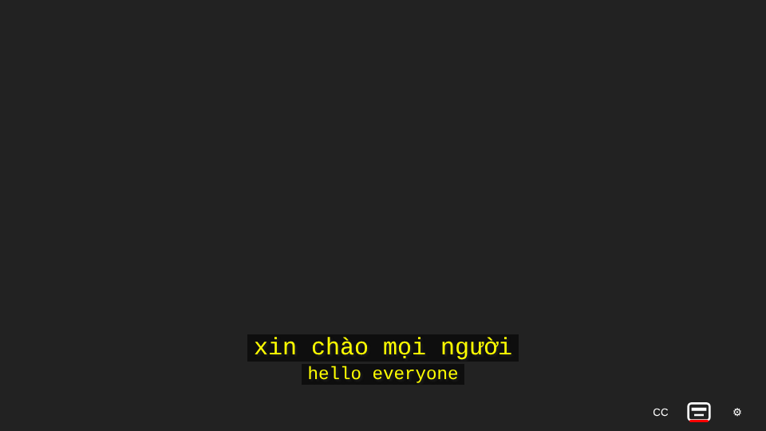
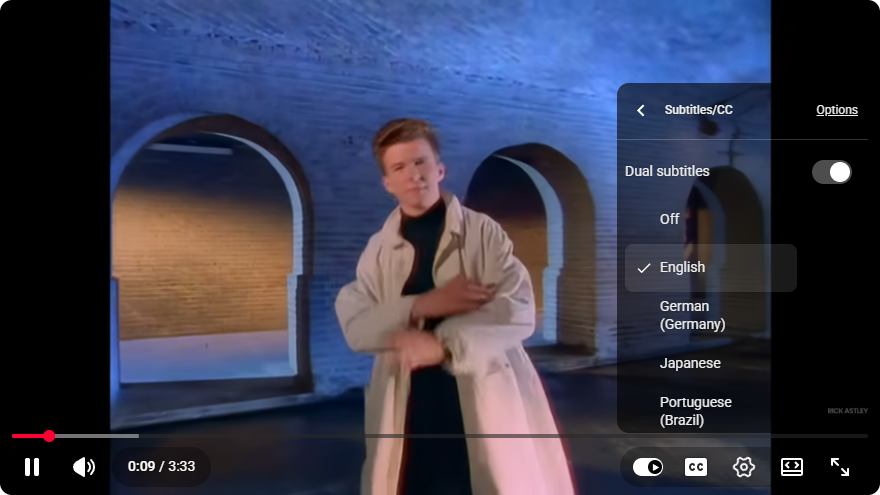
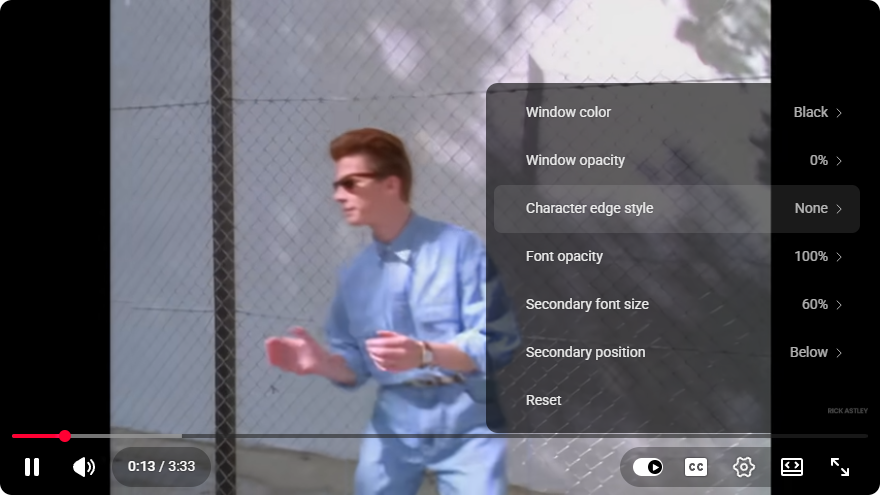

# YouTube Duo Sub

Chrome extension hiển thị **phụ đề kép (duo sub)** trên YouTube: một dòng phụ đề chính và một dòng phụ đề phụ, cùng lúc.







## Tính năng

- **Không thêm nút hay menu riêng, mọi thứ nằm trong menu Cài đặt của YouTube.**
  - *Cài đặt → Phụ đề*: dòng đầu tiên là công tắc **Phụ đề kép** (bật/tắt).
  - *Cài đặt → Phụ đề → Tùy chọn*: thêm **Cỡ chữ phụ đề phụ** và **Vị trí phụ đề phụ**, ngay sau các tùy chọn của YouTube.
- **Tự suy ra sub chính và sub phụ từ thao tác của người dùng.**
  - Sub chính chính là phụ đề YouTube đang hiển thị, chọn như bình thường trong danh sách phụ đề của YouTube (kể cả *Tự động dịch*).
  - Khi đổi phụ đề trong cùng một video, phụ đề vừa bỏ trở thành sub phụ. Ví dụ đang xem English rồi chọn Tiếng Việt thì English thành sub phụ. Lựa chọn này được nhớ cho các video sau. Phụ đề YouTube tự chọn khi mở video không được tính.
  - Nếu sub phụ đã nhớ trùng ngôn ngữ với sub chính, extension dùng chế độ *Tự động* (bên dưới). Popup của extension vẫn cho chọn tay: *Tự động*, *Tắt*, hoặc một ngôn ngữ.
- **Tự động dịch → sub phụ mặc định là ngôn ngữ gốc.** Khi sub chính là bản YouTube tự động dịch (ví dụ English → Tiếng Việt), chế độ *Tự động* hiển thị sub phụ là phụ đề gốc (English). Nếu sub chính không phải bản dịch, sub phụ sẽ là ngôn ngữ ưu tiên (mặc định là ngôn ngữ trình duyệt; nếu trùng với sub chính thì dùng tiếng Anh).
- **Sub phụ nhỏ hơn sub chính.** Mặc định 75% cỡ chữ sub chính, chỉnh được từ 40% đến 95%. Sub phụ có thể đặt dưới hoặc trên sub chính.
- **Dùng chung cấu hình UI sẵn có của YouTube.** Phông chữ, cỡ chữ, màu chữ, độ mờ, màu nền, màu cửa sổ và kiểu viền chữ được sao chép từ phụ đề gốc mà YouTube render. Vì vậy mọi thay đổi trong *Cài đặt → Phụ đề → Tùy chọn* của YouTube áp dụng cho cả hai dòng. Các mục thêm vào menu Cài đặt dùng chính markup của YouTube (`ytp-panel`, `ytp-panel-header`, `ytp-menuitem`…) nên CSS của YouTube vẽ chúng giống hệt mục gốc, ở cả giao diện cũ lẫn mới.
- **Phụ đề auto-generated hiện từng từ theo lúc được nói**, dùng thời gian từng từ (`tOffsetMs`) của YouTube, kiểu cuộn 2 dòng như phụ đề gốc. Không còn hiện trước nguyên câu rồi nhảy cả cụm. Bản dịch tự động của phụ đề auto-generated chỉ có thời gian theo câu, nên các từ được rải theo nhịp giọng nói của track gốc và cũng hiện dần (ngôn ngữ viết liền không dấu cách như tiếng Trung, Nhật, Thái vẫn hiện cả câu).
- Hỗ trợ điều hướng SPA của YouTube, chế độ toàn màn hình/rạp hát, video nhúng (`youtube-nocookie.com`). Khi không có sub phụ (tắt, chưa tải xong, hoặc tải lỗi), đang chạy quảng cáo hoặc tắt CC, extension để nguyên phụ đề gốc của YouTube.
- Giao diện tiếng Việt và tiếng Anh.

## Cài đặt (chế độ nhà phát triển)

1. Tải mã nguồn: `git clone` repo này, hoặc giải nén file zip tạo bằng `npm run package`.
2. Mở `chrome://extensions`, bật **Developer mode**.
3. Bấm **Load unpacked** và chọn thư mục gốc của repo (thư mục chứa `manifest.json`).
4. Mở một video YouTube có phụ đề và bật **CC**. Phụ đề kép sẽ xuất hiện. Bật/tắt trong *Cài đặt → Phụ đề*. Đổi sub phụ bằng cách chọn lần lượt hai phụ đề trong danh sách của YouTube.

Yêu cầu Chrome 111 trở lên (content script chạy trong `world: "MAIN"`).

## Cách hoạt động

```
YouTube player ──(request /api/timedtext + pot token)──► src/page.js (MAIN world)
                                                           │  ghi nhận URL phiên
                                                           │  tải json3 cho sub chính + sub phụ
                                                           │  render overlay, sao chép style phụ đề gốc
                                                           ▼
chrome.storage.sync ◄──► src/bridge.js (isolated world) ◄──postMessage──► page.js
        ▲
        └── popup/popup.html (cài đặt)
```

- YouTube bảo vệ API phụ đề bằng token *proof-of-origin* (`pot`) mà chỉ player tạo được. Extension không tự tạo token. Nó theo dõi request phụ đề do player gửi (hook `fetch`/`XMLHttpRequest`, dự phòng bằng Resource Timing) rồi dùng lại các tham số phiên đó để tải phụ đề khác cùng video. Vì vậy cần **bật CC** để extension hoạt động.
- Phụ đề gốc của YouTube vẫn được render nhưng bị ẩn (`visibility: hidden`). Nhờ đó extension đọc được style đã tính toán (`getComputedStyle`) của phụ đề gốc. Trước khi phụ đề gốc xuất hiện, style được suy ra từ `player.getSubtitlesUserSettings()`.
- Nếu không tải được phụ đề (ví dụ token hết hạn), extension để nguyên phụ đề gốc của YouTube và thử lại sau.

## Cấu trúc mã nguồn

| Tệp | Vai trò |
| --- | --- |
| `manifest.json` | Manifest V3 |
| `src/core.js` | Logic thuần, không phụ thuộc DOM: parse json3, tìm cue theo thời gian, chọn sub phụ, dựng URL, ánh xạ style |
| `src/settings.js` | Schema cài đặt + kiểm tra hợp lệ (`sanitizeSettings`, `sanitizePatch`) |
| `src/page.js` | Script MAIN world: theo dõi request, tải phụ đề, overlay, các mục thêm vào menu Cài đặt của YouTube |
| `src/bridge.js` | Script isolated world: đồng bộ cài đặt giữa `chrome.storage` và trang |
| `src/duosub.css` | Style overlay |
| `popup/` | Popup cài đặt |
| `_locales/` | Chuỗi giao diện (en, vi) |
| `test/core.test.js` | Unit test (`node:test`) |
| `test/e2e/` | Test end-to-end: nạp extension vào Chromium với trang YouTube giả lập |
| `tools/` | Tạo icon, đóng gói zip |

## Tiêu chuẩn mã nguồn

Mã nguồn hướng theo các đặc tính chất lượng của **ISO/IEC 25010**:

- **Dễ bảo trì:** tách logic thuần (`core.js`, `settings.js`) khỏi DOM, JSDoc cho mọi hàm, ESLint (`eslint:recommended`, `strict`, `eqeqeq`, `curly`, `no-var`…), `.editorconfig`.
- **Tin cậy:** unit test + e2e test; mọi lỗi từ API nội bộ của YouTube đều được bắt và phương án dự phòng là phụ đề gốc.
- **Bảo mật:** quyền tối thiểu (chỉ `storage`); không dùng `innerHTML` (tương thích Trusted Types của YouTube); mọi dữ liệu cài đặt đi qua `sanitizeSettings`/`sanitizePatch`; `postMessage` giới hạn theo `location.origin`.
- Ngôn ngữ ECMAScript 2022 (ECMA-262, tương ứng ISO/IEC 22275), strict mode. Mã ngôn ngữ theo ISO 639 / BCP 47 (`en`, `vi`, `pt-BR`…).

## Phát triển

```bash
npm install          # ESLint
npm run lint         # kiểm tra mã
npm test             # unit test
npm run test:e2e     # e2e (cần Playwright + Chromium)
npm run package      # tạo dist/youtube-duo-sub-<version>.zip
npm run icons        # tạo lại icon (Python + Pillow)
```

## Giới hạn

- Vị trí cửa sổ phụ đề kéo thả của YouTube và phụ đề có định vị đặc biệt (srv3) không được giữ nguyên; overlay luôn căn giữa phía dưới.
- Extension dựa vào API nội bộ của player YouTube (`getOption('captions', …)`, `getPlayerResponse()`) và cấu trúc DOM của menu Cài đặt (`.ytp-panel-options`, `.ytp-subtitles-options-menu-item`), có thể thay đổi khi YouTube cập nhật.
